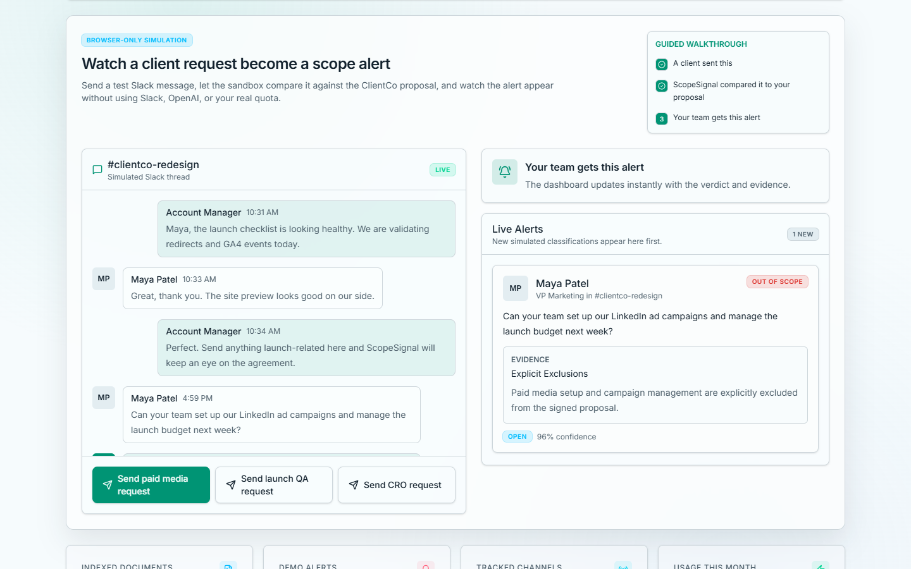
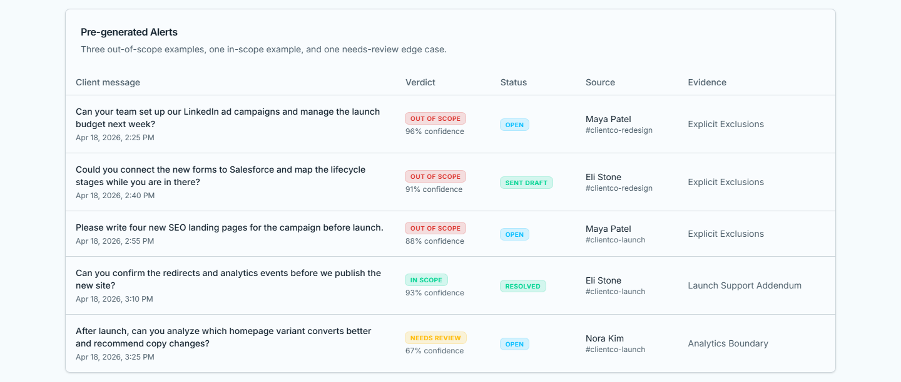
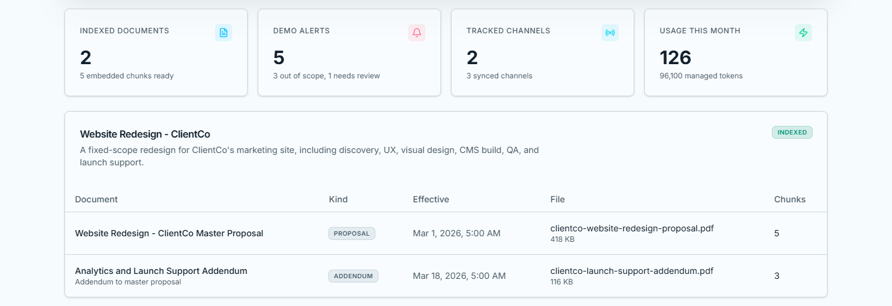
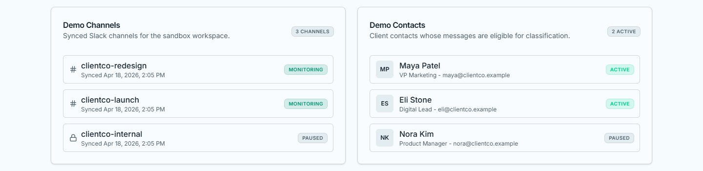

# ScopeSignal

    

Contract-aware scope-creep detection for agencies. ScopeSignal reads the signed proposal and any addendums, watches approved client channels in Slack, and warns the account manager when a client request looks like work that isn't in the contract, before anyone says yes to it.

**Try it live:** the [ScopeSignal sandbox](https://jahanzaib-portfolio.pages.dev/demos/scopesignal/sandbox) runs in the browser with preloaded data. No sign-up, and nothing is saved.



A client asks for paid-media work, and ScopeSignal flags it as out of scope, citing the clause in the signed proposal.

<details>
<summary>More screenshots</summary>





</details>

## How it works

1. The agency uploads a proposal PDF (and later change orders).
2. The document worker parses, chunks and embeds it, keeping effective dates so addendums override older terms.
3. A message from an approved client contact in a watched Slack channel is queued as a job.
4. The scope worker pulls recent thread context and the most relevant contract chunks, then asks the model to classify the request as **in scope**, **out of scope** or **needs review**, with a confidence score and rationale.
5. Out-of-scope or uncertain requests create an alert in the dashboard and a Slack DM / email to the account manager.
6. Feedback on alerts is recorded to tune false positives.

## Features

- Proposal and addendum ingestion with PDF parsing, chunking and pgvector retrieval
- Slack OAuth install, signed Events API endpoint, prefiltering and an idempotent job queue
- Background workers for document indexing and scope classification
- Alert inbox with rationale and the contract clauses each decision relied on
- Sandbox mode to try the classifier without connecting Slack
- Bring-your-own OpenAI key per workspace, plus monthly usage quotas
- Lifetime license codes (stored only as SHA-256 hashes) that unlock tiered monthly quotas
- Supabase Auth, row-level security on every table, encrypted Slack token storage
- Email notifications through Resend

## Tech stack

| Layer | Technology |
|---|---|
| App | Next.js 16 (App Router, server actions), React 19, TypeScript |
| UI | Tailwind CSS, Radix primitives, lucide icons |
| Data | Supabase (Postgres, pgvector, Auth, Storage, Realtime) |
| AI | OpenAI embeddings and classification |
| Messaging | Slack OAuth + Events API, Resend email |
| Workers | Node.js workers run with `tsx` |
| Quality | Vitest, ESLint, Prettier, `tsc --noEmit` |

## Getting started

**Requirements:** Node.js 20+, a Supabase project (or the Supabase CLI for local dev), an OpenAI key and a Slack app.

```bash
npm install
cp .env.example .env.local    # Supabase, Slack, OpenAI and Resend settings
npm run db:push               # apply migrations in supabase/migrations
npm run db:seed               # optional demo data
npm run dev                   # web app on http://localhost:3000

# in separate terminals
npm run worker:documents      # parses and indexes uploaded proposals
npm run worker:scope          # classifies queued Slack messages
```

Slack app setup (scopes, event subscriptions, interactivity, OAuth redirect) is covered in [docs/slack-setup.md](docs/slack-setup.md).

### Sandbox only

The sandbox runs entirely in the browser on preloaded data. To build just the sandbox, with no Supabase, Slack or OpenAI settings:

```bash
NEXT_PUBLIC_SANDBOX_ONLY=1 npm run build
NEXT_PUBLIC_SANDBOX_ONLY=1 npm start    # every route redirects to /sandbox
```

Set `SANDBOX_BASE_PATH` (for example `/demos/scopesignal`) to serve it from a sub-path. This is how the live demo is built.

## Evaluation

The parser, retrieval settings, prompt and model were chosen from measurements, not by eye. [docs/evaluation.md](docs/evaluation.md) covers the PDF parser benchmark, the retrieval parameter sweep, prompt calibration, the model comparison, and the rules that send uncertain cases to human review.

```bash
npm test                          # unit tests
npm run evaluate:retrieval
npm run benchmark:classification
```

## Project structure

```
app/         App Router pages: dashboard, proposals, alerts, sandbox, settings, auth
app/api/     Slack OAuth and events endpoints
lib/         OpenAI, retrieval, PDF parsing, Slack, Supabase, usage and email helpers
workers/     document-worker and scope-worker
supabase/    migrations (schema, RLS policies, queue, vector search) and seed
docs/        setup guides, evaluations, benchmarks, sample proposal
```

## Production notes

- Keep `SCOPESIGNAL_VERBOSE_WORKER_LOGS=false` so worker logs never contain contract text or Slack transcripts.
- Tables for chunks, alerts and usage are service-owned; user-facing writes go through server actions or narrow RPCs.

_Developed April 2026. Imported from a private repository; the commit history was left out because it contained credentials._

## License

MIT. See [LICENSE](LICENSE).
